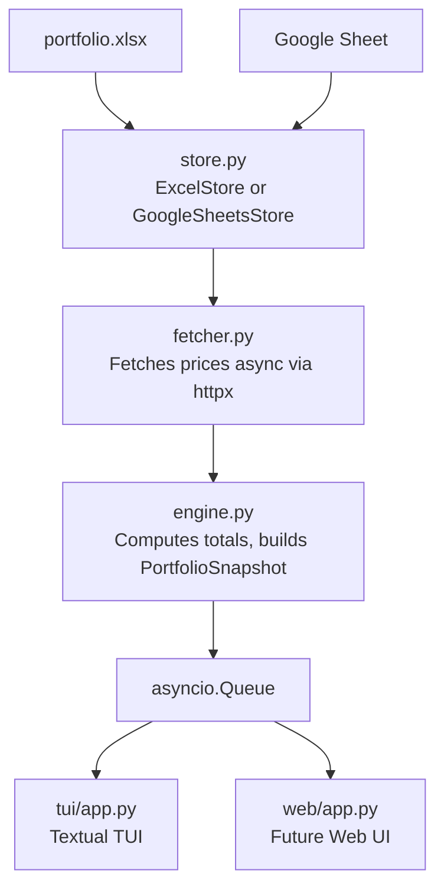
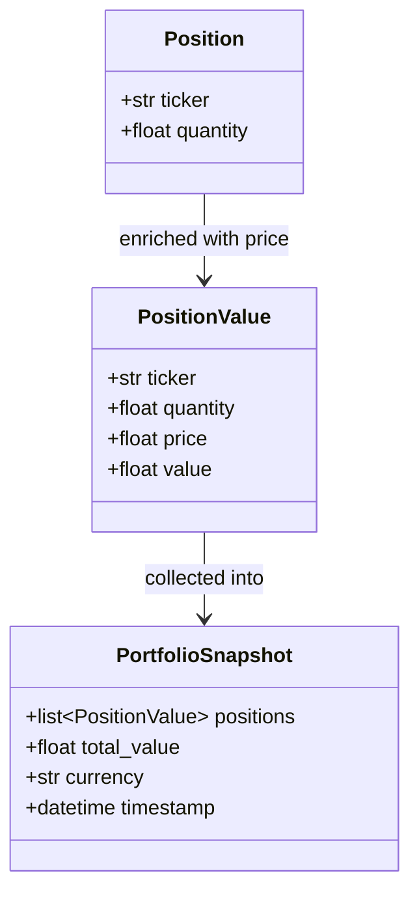

# Portfolio Tracker

A near-real-time terminal dashboard that reads your stock holdings from an Excel
file or a Google Sheet and displays their current market value, refreshed
automatically.

---

## Architecture

### Data Pipeline

Data flows in one direction: from your portfolio store (Excel file or Google
Sheet), through price fetching, into a queue that feeds any number of UI
consumers independently.



### Data Models

The app uses three Pydantic models to represent data at different stages of the
pipeline. `Position` is the raw input from Excel. It gets enriched with a live
price into `PositionValue`, and a collection of those is bundled into a
`PortfolioSnapshot` that gets pushed to the queue on every refresh cycle.



---

## Requirements

- Python 3.12 or higher
- [uv](https://docs.astral.sh/uv/) package manager

### Installing uv (if not already installed)

```bash
curl -LsSf https://astral.sh/uv/install.sh | sh
```

Then restart your terminal, or run:

```bash
source $HOME/.local/bin/env
```

---

## Setup

1. **Clone or download this project**, then navigate into the folder:

   ```bash
   cd portfoliotracker
   ```

2. **Install dependencies:**

   ```bash
   uv sync
   ```

3. **Create your settings file** by copying the example:

   ```bash
   cp .env.example .env
   ```

   `.env` holds your local settings and is never committed to git:

   | Setting | Default | Meaning |
   |---|---|---|
   | `STORAGE_BACKEND` | `excel` | Where the portfolio lives: `excel` or `gsheets` |
   | `EXCEL_PATH` | `data/portfolio.xlsx` | The Excel file (when `STORAGE_BACKEND=excel`) |
   | `GSHEETS_SPREADSHEET_ID` | — | The Google Sheet (when `STORAGE_BACKEND=gsheets`) |
   | `REFRESH_INTERVAL_SECONDS` | `30` | Seconds between price refreshes |
   | `BENCHMARK_TICKER` | `^BVSP` | Index shown on the Summary tab |

   Settings are read at startup — restart the app after changing them.

4. **Choose where your portfolio lives** — see the next section. If you only
   use one computer, the Excel file works out of the box.

---

## Where your portfolio lives: Excel or Google Sheets

| | Excel file (default) | Google Sheet |
|---|---|---|
| Best for | One computer | Several computers sharing the same data |
| Setup | None — edit `data/portfolio.xlsx` | One-time Google setup, then two lines in `.env` per computer |
| Edits | Saved to the local file | Saved to the shared sheet; other computers see them on their next refresh |

Both use exactly the same layout (same tabs, same columns — see
[Adding tickers](#adding-tickers-to-the-excel-file)). The TUI, the edit keys and
the B3 import work the same with either one.

### Google Sheets: one-time setup (done once, ever)

You only do this the first time. If the sheet already exists and is shared with
the service account, skip to [setting up a computer](#google-sheets-setting-up-a-computer).

1. **Put the portfolio in Google Sheets.** Upload `data/portfolio.xlsx` to Google
   Drive, open it, and choose **File → Save as Google Sheets**. Check that:
   - there is **no `.XLSX` badge** next to the name (otherwise it's still an
     Excel file and the API can't read it);
   - the positions tab is **first**, and the fixed-income tab is named exactly
     `FixedIncome`.
2. **Create a Google Cloud project** (free, no billing needed) at
   [console.cloud.google.com](https://console.cloud.google.com): project picker
   → **New Project**.
3. **Enable the Google Sheets API**: search "Google Sheets API" → **Enable**.
4. **Create a service account** (a "robot" Google account the app logs in as):
   search "Service Accounts" → **Create service account** → give it a name →
   skip the roles step → **Done**.
5. **Download its key**: open the service account → **Keys** → **Add key →
   Create new key → JSON**. Keep this file safe — anyone who has it can edit
   your sheet. Never commit it or send it by email/chat.
6. **Share the sheet with the robot**: in the sheet, click **Share**, paste the
   service account's email (the `client_email` in the key file, ending in
   `.iam.gserviceaccount.com`), choose **Editor**, untick "Notify people".
7. **Note the sheet ID** — the long part of the URL between `/d/` and `/edit`:
   `https://docs.google.com/spreadsheets/d/`**`THIS_PART`**`/edit`

### Google Sheets: setting up a computer

Do this on every computer that runs the app (including the first one):

1. **Get the code and install dependencies**:

   ```bash
   git clone https://github.com/lermen/portfoliotracker.git
   cd portfoliotracker
   uv sync
   ```

2. **Copy the key file** from the one-time setup (use a password manager or USB
   stick) to `~/.config/portfolio/service-account.json`, and make it private:

   ```bash
   mkdir -p ~/.config/portfolio
   mv /path/to/downloaded-key.json ~/.config/portfolio/service-account.json
   chmod 600 ~/.config/portfolio/service-account.json
   ```

   (To keep it somewhere else, set `GSHEETS_CREDENTIALS_PATH` in `.env` to the
   full path — `~` is not expanded there.)

3. **Create `.env`** with the backend and your sheet ID:

   ```bash
   cp .env.example .env
   ```

   then edit it so it contains:

   ```
   STORAGE_BACKEND=gsheets
   GSHEETS_SPREADSHEET_ID=your-sheet-id
   ```

4. **Run it**: `uv run portfolio`. The totals should match what the other
   computers show.

To go back to the local Excel file at any time, set `STORAGE_BACKEND=excel`.
If you edited the sheet since switching, first download it from Google Sheets
(**File → Download → .xlsx**) and save it as `data/portfolio.xlsx`.

> **Google's limits:** each refresh makes about 4 requests and Google allows 60
> per minute, so any `REFRESH_INTERVAL_SECONDS` of 10 or more is safe.

---

## Adding tickers to the Excel file

The tool reads from `data/portfolio.xlsx` by default (or from your Google Sheet
when `STORAGE_BACKEND=gsheets` — same layout). The first tab must follow this
structure:

| Column A   | Column B | Column C  | Column D | Column E      |
|------------|----------|-----------|----------|---------------|
| Ticker     | Quantity | Exchange  | Category | Average Price |
| AAPL       | 10       | NASDAQ    | Stock    | 150.00        |
| PETR4.SA   | 100      | B3        | Stock    | 32.10         |
| HGLG11.SA  | 50       | B3        | FII      |               |
| SAP.DE     | 20       | Frankfurt | Stock    | 180.50        |

**Rules:**

- **Row 1 is a header row** — it is skipped automatically. Labels do not matter.
- **Column A** — stock ticker symbol in Yahoo Finance format (see suffixes below).
  Must be a valid Yahoo Finance ticker.
- **Column B** — number of shares (or units) you hold. Must be greater than 0.
  Decimals are supported (e.g. `0.5` for half a share).
- **Column C** — exchange name for display purposes only (e.g. `NASDAQ`, `B3`,
  `Frankfurt`). Optional — leave blank if not needed.
- **Column D** — asset category for display purposes only (e.g. `Stock`, `FII`,
  `ETF`, `Crypto`). Optional — leave blank if not needed.
- **Column E** — your average purchase price, in the asset's own currency. Used
  for P&L. Optional — leave blank and P&L shows `----`.
- Blank rows are ignored.

A second tab named **`FixedIncome`** (optional) holds fixed-income positions:
column A is a name, column B the current amount in BRL.

### Ticker format by exchange

Yahoo Finance uses suffixes to identify the exchange. The ticker in column A must
include the correct suffix for non-US assets:

| Exchange | Suffix | Example |
|---|---|---|
| NASDAQ / NYSE (US) | *(none)* | `AAPL`, `MSFT` |
| B3 (Brazil) | `.SA` | `PETR4.SA`, `VALE3.SA`, `HGLG11.SA` |
| Frankfurt / XETRA | `.F` or `.DE` | `BMW.F`, `SAP.DE` |
| London Stock Exchange | `.L` | `HSBA.L` |
| Crypto (USD) | `-USD` | `BTC-USD`, `ETH-USD` |

### Example tickers

| Asset | Ticker | Exchange | Category |
|---|---|---|---|
| Apple | `AAPL` | NASDAQ | Stock |
| Microsoft | `MSFT` | NASDAQ | Stock |
| Petrobras PN | `PETR4.SA` | B3 | Stock |
| Vale ON | `VALE3.SA` | B3 | Stock |
| CSHG Logística FII | `HGLG11.SA` | B3 | FII |
| SAP SE | `SAP.DE` | Frankfurt | Stock |
| Bitcoin | `BTC-USD` | — | Crypto |
| S&P 500 ETF | `SPY` | NASDAQ | ETF |

> Prices are sourced from **Yahoo Finance** via `yfinance`. Any ticker that works
> on finance.yahoo.com should work here, including ETFs, FIIs, and crypto pairs.

### How to edit the file

Use the editing keys inside the app (see [Running the tracker](#running-the-tracker)),
or edit the data directly:

- **Excel:** open `data/portfolio.xlsx` in any spreadsheet application and save.
- **Google Sheets:** edit the sheet in your browser — it saves automatically.

The tracker re-reads the data on each refresh cycle.

---

## Importing positions from a broker export (B3)

Instead of editing quantities by hand, you can sync them automatically from a
**B3 "posição" export** — the multi-sheet `.xlsx` you download from your broker's
investor area (filename looks like `posicao-2026-07-11-11-28-57.xlsx`).

```bash
# 1. Preview the changes without writing anything:
uv run portfolio import posicao-2026-07-11-11-28-57.xlsx --dry-run

# 2. Apply them (asks for confirmation first):
uv run portfolio import posicao-2026-07-11-11-28-57.xlsx
```

The importer reads the export, matches each ticker against your portfolio
(`ITSA4` in the export ↔ `ITSA4.SA` in the file), and updates the quantities to
match. It updates whichever store `STORAGE_BACKEND` selects — the Excel file or
the Google Sheet (the output's `Target:` line tells you which). It shows a plan and waits for your confirmation before writing.

### What it reads

Quantities are **summed across every tradable sheet** — `Acoes`, `Empréstimos`
(lent shares still count as yours), `ETF`, and `Fundo de Investimento`. The
`Renda Fixa` and `Tesouro Direto` sheets are skipped, since those have no market
ticker (track them in the `FixedIncome` sheet instead).

### Options

| Flag | Description |
|---|---|
| `--dry-run` | Show the plan but write nothing. |
| `-y`, `--yes` | Apply without the interactive confirmation prompt (for scripts). |
| `--add-new` | Also add tickers found in the export but missing from your portfolio. |
| `--portfolio PATH` | Update this Excel file instead (default: the store selected by `STORAGE_BACKEND`). |

### Example output

```
Portfolio import — posicao-2026-07-11-11-28-57.xlsx
Target: data/portfolio.xlsx

Quantity updates (6):
  FLRY3.SA   1760 -> 2060
  HYPE3.SA   1253 -> 1453
  KLBN11.SA  1515 -> 2715
  BBAS3.SA   1390 -> 1590
  B5P211.SA  100 -> 147
  JURO11.SA  260 -> 360

New tickers in export (2):
  RECR12.SA  qty 47  [Fund]  — skipped (use --add-new to add)
  URPR12.SA  qty 432  [Fund]  — skipped (use --add-new to add)

Unchanged (already correct): 35
In portfolio but not in export (2, left untouched): BTC-USD, SAP.DE

Apply these changes? [y/N]
```

### Safety

- **Preview first** — nothing is written until you confirm (or pass `--yes`).
- **Never removes** — tickers in your portfolio but absent from the export (e.g.
  non-B3 assets like `SAP.DE` or `BTC-USD`) are reported and left untouched.
- **Additions are opt-in** — new tickers are only added with `--add-new`.
- **Non-destructive to your data** — only the `Quantity` cells change; your
  `Average Price` column, other rows, and the `FixedIncome` sheet are preserved.
- **Google Sheets rate limit** — each update takes about 3 requests and Google
  allows 60 per minute, so an import with more than ~20 updates may stop with a
  "rate limit reached" error. Updates already made are kept; wait a minute and
  run the import again — it only applies what's still different.

---

## Running the tracker

```bash
uv run portfolio
```

The terminal dashboard will launch. It shows a table with each position's
current price, quantity, and total value, plus a running portfolio total at the
bottom.

| Column | Description |
|---|---|
| Ticker | Stock symbol (with exchange suffix where applicable) |
| Exchange | Exchange name as entered in the Excel file |
| Category | Asset category as entered in the Excel file |
| Quantity | Number of shares held |
| Price | Latest market price |
| Value | Quantity × Price |

Prices refresh automatically every 30 seconds (or whatever is set in `.env`).

**Keyboard shortcuts:**

| Key | Action |
|---|---|
| `q` | Quit the application |
| `h` | Hide / show values (privacy mode) |
| `e` | Cycle the exchange filter |
| `c` | Cycle the category filter |
| `escape` | Collapse the expanded detail row |
| `p` / `v` / `n` | Sort by P&L / Value / Name |
| `d` / `w` | Sort by 24h / 1-week change |
| `u` | Edit the selected position's quantity |
| `P` | Edit the selected position's average price |
| `A` | Add a new position |
| `D` | Delete the selected position |

> Editing keys (`u`, `P`, `A`, `D`) write straight to your portfolio (the Excel
> file or the Google Sheet) and the table refreshes within a second. `P`, `A`, and `D` use capital letters
> (Shift+key); `u` works with or without Shift.

---

## Running the tests

```bash
uv run pytest tests/unit/ -v
```

---

## Troubleshooting

**"No price returned for TICKER"**
The ticker symbol is not recognised by Yahoo Finance. Double-check the symbol
at finance.yahoo.com.

**"Failed to parse data/portfolio.xlsx"**
The Excel file is missing, open in another application with a write lock, or
does not follow the expected column layout. Close the file in other apps and
verify columns A (Ticker) and B (Quantity) are populated from row 2 onward.
Columns C (Exchange) and D (Category) are optional.

**"Google Sheets error 403: share the sheet with …"**
The sheet isn't shared with the service account. In the sheet click **Share**
and add the email shown in the message as **Editor**.

**"Sheet … not found"**
`GSHEETS_SPREADSHEET_ID` in `.env` is wrong, or the sheet isn't shared with the
service account. Copy the ID again from the sheet's URL.

**"the file is still an .xlsx"**
The sheet in Drive is an uploaded Excel file, not a Google Sheet. Open it, choose
**File → Save as Google Sheets**, share the new copy with the service account,
and put the new ID in `.env`.

**"Google credentials file not found"**
The key file isn't at `~/.config/portfolio/service-account.json` (or at
`GSHEETS_CREDENTIALS_PATH`). Copy it there — see
[setting up a computer](#google-sheets-setting-up-a-computer).

**Prices are stale**
The refresh interval is controlled by `REFRESH_INTERVAL_SECONDS` in `.env`.
Lowering this value (e.g. to `10`) will fetch prices more frequently, but may
trigger Yahoo Finance rate limits.
